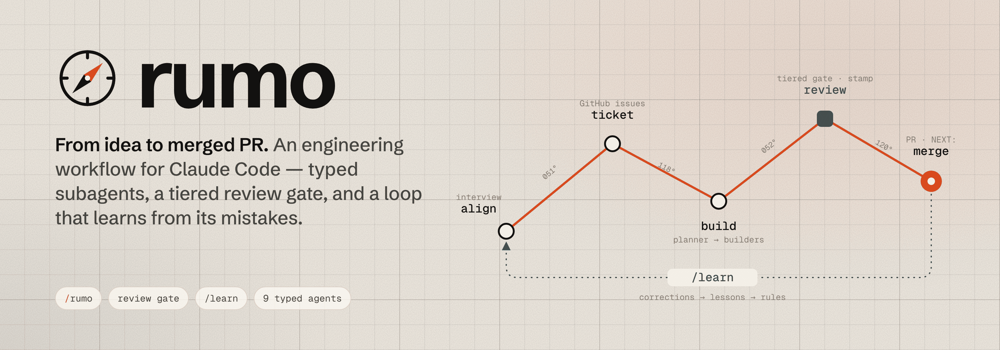
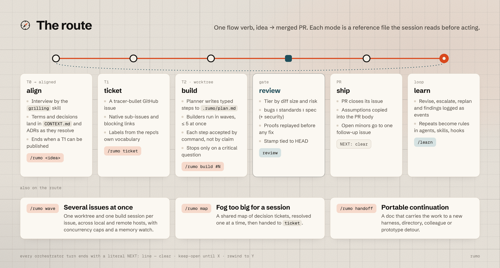
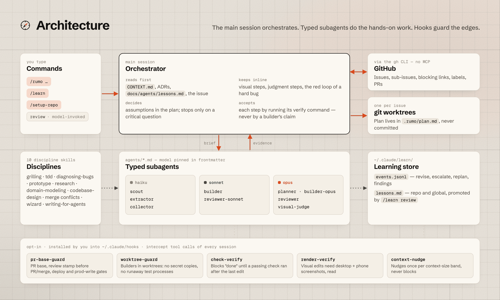
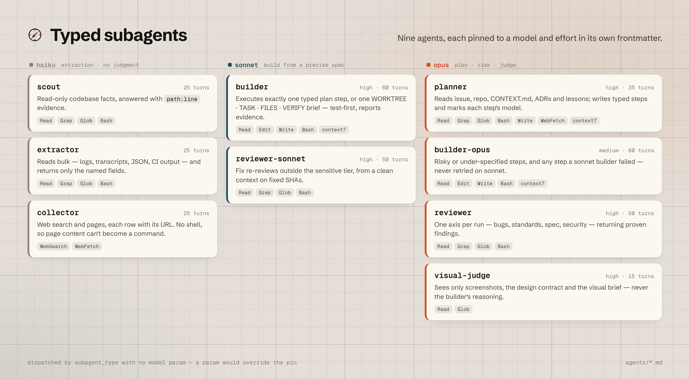
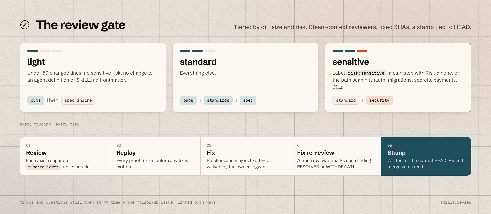
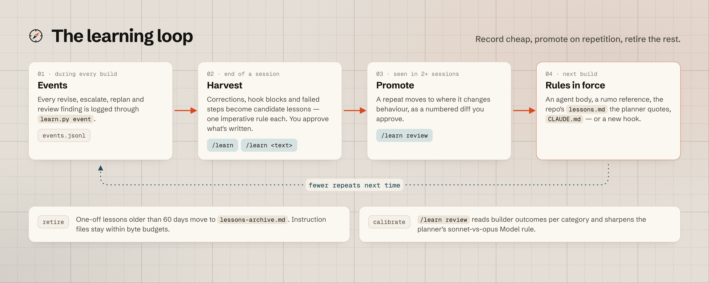

<p align="center">
  <picture>
    <source media="(prefers-color-scheme: dark)" srcset="docs/assets/banner-dark.png">
    
  </picture>
</p>

<p align="center">
  <a href="https://github.com/vkmtx/rumo-workflow/releases"></a>
  <a href="https://github.com/vkmtx/rumo-workflow/actions/workflows/ci.yml"></a>
  <a href="LICENSE"></a>
  <a href="https://github.com/vkmtx/rumo-workflow/wiki"></a>
</p>

**rumo** (Portuguese for *heading*, *course*) is a Claude Code plugin that takes engineering work from a raw idea to a merged pull request. You type one command. The main session aligns the idea with you, turns it into GitHub issues, plans it, and orchestrates typed subagents that build, review and ship it — then feeds every correction back into the rules so the same mistake doesn't happen twice.

It is opinionated, small on the surface and strict underneath: four commands, nine typed agents, a tiered review gate, opt-in safety hooks, and ten discipline skills.

```text
/rumo add rate limiting to the public API     # align: an interview until the idea is sharp
/rumo ticket                                  # publish it as tracer-bullet GitHub issues
/rumo build #42                               # plan → build in waves → review → PR
/learn                                        # turn this session's corrections into rules
```

## Why

Long agent sessions fail in predictable ways: they plan in the same context they build in, accept their own claims as proof, review their own work, skip the boring checks, and repeat last week's mistake. rumo is built against each of those:

| Failure mode | What rumo does |
|---|---|
| One giant context does everything | The main session **orchestrates**; typed subagents with pinned models do the hands-on work from short briefs. |
| "Done" means "the agent said so" | Each step is **accepted by command** — its verify command is re-run by the orchestrator. |
| The author reviews itself | **Clean-context reviewers** on fixed SHAs, one axis each, proofs replayed before any fix. |
| Questions stall unattended runs | Defaults become recorded **assumptions**; only a **critical question** (irreversible or unknowable) stops a build. |
| The same mistake, every week | **`/learn`** logs corrections and promotes anything seen twice into an agent, a skill, a hook or `CLAUDE.md`. |

## The route

<picture>
  <source media="(prefers-color-scheme: dark)" srcset="docs/assets/workflow-dark.png">
  
</picture>

| Command | What it does |
|---|---|
| `/rumo <idea>` | **align** — interview (the `grilling` skill) until the idea is sharp; terms and decisions land in `CONTEXT.md` and ADRs as they resolve. |
| `/rumo ticket` | **ticket** — publish tracer-bullet GitHub issues with native sub-issues, blocking links and the repo's own labels. |
| `/rumo build #N` | **build** — worktree → planner writes typed steps → builders in waves (≤ 5 at once) → accept by command → tiered review → PR. |
| `/rumo wave` | **wave** — several independent issues at once: one worktree and one build session per issue, across local and remote hosts, with concurrency caps and a memory watch. Requires [Orca](https://github.com/stablyai/orca). |
| `/rumo map` | **map** — fog too big for one session becomes a map of decision tickets, resolved one at a time. |
| `/rumo handoff` | **handoff** — a portable continuation document for a new session, harness or colleague. |
| `review` | The pre-PR gate. Model-invoked: runs at the close of every build, or when you ask for a review. |
| `/learn` | Harvest this session's corrections · record one lesson · `review` to promote repeats into rules. |
| `/setup-repo` | One-pass bootstrap of a repo: `docs/agents/*`, `CONTEXT.md`, a `CLAUDE.md` block. |

Every orchestrator turn ends with a literal `NEXT:` line — `clear`, `keep-open until X` or `rewind to Y` — so you always know whether the session is finished.

## Architecture

<picture>
  <source media="(prefers-color-scheme: dark)" srcset="docs/assets/architecture-dark.png">
  
</picture>

### Typed subagents

Each agent in [`agents/`](agents) pins its model and effort in frontmatter. Skills dispatch them by `subagent_type` with **no `model` parameter**, so the pin always holds. The planner marks every step's model; a failed sonnet step escalates to opus and is never retried on sonnet.

<picture>
  <source media="(prefers-color-scheme: dark)" srcset="docs/assets/agents-dark.png">
  
</picture>

### The review gate

<picture>
  <source media="(prefers-color-scheme: dark)" srcset="docs/assets/review-gate-dark.png">
  
</picture>

The tier comes from the diff, not from the author's opinion: a path scan over auth, migrations, secrets, payments and CI files forces the **sensitive** tier even when the plan says `Risk: none`. The **stamp** is written only by `review-stamp.sh` for the current `HEAD`; the PR and merge gates read it.

### The learning loop

<picture>
  <source media="(prefers-color-scheme: dark)" srcset="docs/assets/learn-loop-dark.png">
  
</picture>

## Install

**Requirements:** [Claude Code](https://docs.claude.com/en/docs/claude-code), `git`, and the [GitHub CLI](https://cli.github.com) authenticated (`gh auth login`). Python 3 for the helper scripts. `/rumo wave` additionally needs [Orca](https://github.com/stablyai/orca).

From inside Claude Code:

```text
/plugin marketplace add vkmtx/rumo-workflow
/plugin install rumo@rumo
```

Or from a clone:

```bash
git clone https://github.com/vkmtx/rumo-workflow.git rumo && cd rumo
./scripts/install.sh        # validates the plugin, adds the marketplace, installs rumo@rumo
```

Then, in the repository you want to work on:

```text
/setup-repo                 # once per repo
/rumo <what you want to build>
```

Claude Code runs a cached copy of installed plugins. After pulling a new version, run `claude plugin update rumo@rumo`.

### Optional: safety hooks

[`scripts/hooks-staged/`](scripts/hooks-staged) holds the hooks rumo was designed with — a PR/merge/deploy gate that reads the review stamp, a worktree guard for builders, verify-before-done and render-before-done checks, and a context-size nudge. They are **opt-in**: nothing installs them for you. Read each header, run its tests, and copy the ones you want into `~/.claude/hooks/`. See the [Hooks](https://github.com/vkmtx/rumo-workflow/wiki/Hooks) wiki page.

## Documentation

The **[wiki](https://github.com/vkmtx/rumo-workflow/wiki)** is the full manual: getting started, core concepts, one page per mode, the review gate, `/learn`, agents, hooks, configuration, glossary, design history and troubleshooting.

In this repository:

- [`CONTEXT.md`](CONTEXT.md) — the domain glossary (stamp, open finding, waiver, critical question, assumption, …).
- [`docs/design/`](docs/design) — design records: the [0.3 orchestrator](docs/design/0.3-orchestrator.md) and the [0.8 bottleneck analysis](docs/design/0.8-bottlenecks.md).
- [`docs/adr/`](docs/adr) — architecture decision records.
- [`CHANGELOG.md`](CHANGELOG.md) — every release since 0.1.0.

## Development

```bash
bash scripts/test-all.sh          # every *_test.sh, *.test.sh and *_test.py in the tree
claude plugin validate .          # manifest check
bash scripts/leak-scan.sh         # no personal data, hosts or credential shapes
```

See [CONTRIBUTING.md](CONTRIBUTING.md) for the version-bump rule and conventions, and [SECURITY.md](SECURITY.md) to report a vulnerability privately.

## Credits

The ten discipline skills in [`skills/discipline/`](skills/discipline) are ported from [mattpocock/skills](https://github.com/mattpocock/skills) (MIT) with their mechanism intact. See [THIRD_PARTY_NOTICES.md](THIRD_PARTY_NOTICES.md).

## License

[MIT](LICENSE)
