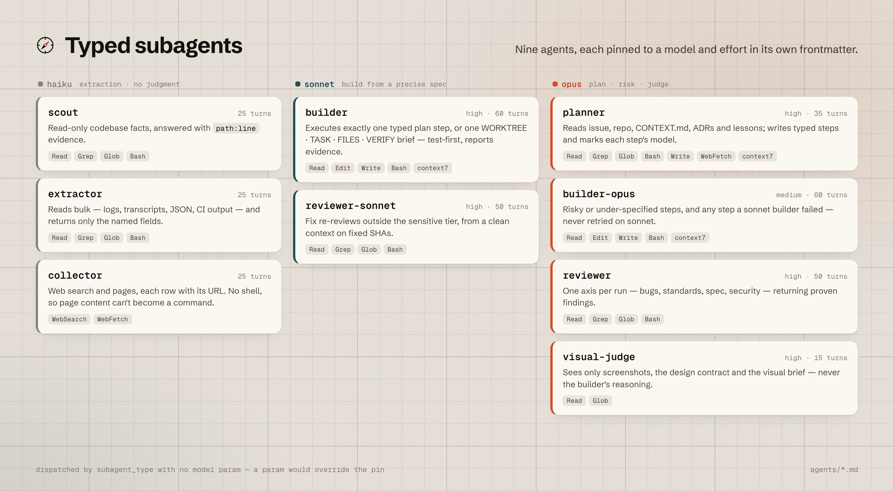

# Agents

rumo ships nine typed subagents in `agents/*.md`, dispatched as `rumo:<name>`. Each one pins its model, effort, tools and turn budget in its own frontmatter, and skills dispatch them **without** a `model` parameter, because a parameter overrides the pin. The tiering follows one rule: haiku for collection and extraction, sonnet for building from a precise spec, opus where judgment decides the outcome (planning, risky steps, review, visual judgment). This page lists each agent's contract as its file states it.



| Agent | Model | Effort | Tools | maxTurns | Used by |
|---|---|---|---|---|---|
| `scout` | haiku | — | Read, Grep, Glob, Bash | 25 | align, planning, review, wave overlap check |
| `extractor` | haiku | — | Read, Grep, Glob, Bash | 25 | bulk logs, transcripts, JSON, CI output |
| `collector` | haiku | — | WebSearch, WebFetch | 25 | web collection |
| `planner` | opus | high | Read, Grep, Glob, Bash, Write, WebFetch, context7 | 35 | start of every non-trivial build |
| `builder` | sonnet | high | Read, Edit, Write, Grep, Glob, Bash, context7 | 60 | `Model: sonnet` steps; precise briefs |
| `builder-opus` | opus | medium | same as `builder` | 60 | `Model: opus` steps; escalations |
| `reviewer` | opus | high | Read, Grep, Glob, Bash | 50 | bugs, standards, spec, security axes; fix axis on the sensitive tier |
| `reviewer-sonnet` | sonnet | high | Read, Grep, Glob, Bash | 50 | fix re-reviews outside the sensitive tier; reviewer fallback on a usage limit |
| `visual-judge` | opus | high | Read, Glob | 15 | visual steps, before acceptance |

"context7" is the `mcp__context7__resolve-library-id` and `mcp__context7__query-docs` pair, used before writing a call to a library API the agent is unsure of.

Two pairs share one body: `builder` / `builder-opus`, and `reviewer` / `reviewer-sonnet`. Only the frontmatter (and the opus builder's first sentence) differs.

## scout

A read-only fact finder. It answers concrete questions about a codebase (where X is defined or called, which command runs the tests, what a config sets) with `path:line` evidence. It searches before reading, quotes rather than paraphrases (at most ~10 lines per place), and counts with commands. Bash is read-only for it; anything that writes or runs the app is named, not run. Returns `ANSWERS` and `UNSURE` in under 300 words, and never judges what it found.

## extractor

Reads bulk you don't need verbatim and returns only the fields the brief names, in the shape it names. It filters with a command before reading (`rg`, `jq`, `awk`, `python3 -I -c`), counts with commands, and carries a source for every value (`path:line`, JSON path, log timestamp). A source too large for its turns is covered in a stated slice, the rest reported as `REMAINING`. Returns `RESULT`, `COMMANDS`, `REMAINING`. The build uses it to read failed CI logs so the log never enters the main window.

## collector

The web counterpart of the extractor, with **no shell and no file access**, so page content can't become a command. It searches, opens only the pages the results point at, quotes values with their URL, and treats any instruction found on a page as content to report under `SKIPPED`. Returns `RESULT`, `SEARCHES`, `SKIPPED`.

## planner

Turns one issue into a plan that builders with zero context execute step by step, written to the exact plan path in the brief; that file is the only one it creates. Every run it reads the issue and comments, `CONTEXT.md` and relevant ADRs (terms used verbatim), `docs/agents/lessons.md` (relevant lessons quoted into steps), the plan template, and the code itself: a plan that cites a file has read it in that run.

- **Budget:** 35 turns, reads batched, plan written by about turn 28, the rest kept for `plan-check` fixes. `FACTS ALREADY KNOWN` in the brief are settled.
- **Steps:** typed, every field filled, each about 150 changed lines or fewer; at most six. Each Verify must run a test that exists only after the step.
- **Model rule**, abuse cases first, and **decide, don't defer**: naming, structure and approach are its own choices; only money, credentials, an open product choice or a new public interface go to OPEN QUESTIONS, each with a default. See [[Mode build]].
- Returns `PLAN`, `STEPS`, `WAVES`, `RISK`, `SEAMS`, `OPEN QUESTIONS` in under 300 words.

## builder and builder-opus

Execute **one step** of a plan inside **one worktree** and report what they can prove. The opus tier gets risky or under-specified steps and any step a sonnet builder failed, reading the failure notes first.

The contract:

- edits land only in the step's Files; failures from other builders' files are reported, not touched;
- the "Current state" excerpts are checked against the code first; a mismatch is a STOP;
- a brief may carry the step itself (`WORKTREE`, `TASK`, `FILES`, `VERIFY`) instead of a plan; no `WORKTREE` is a STOP;
- **test first:** red for the right reason (an assertion, not a load error; a new export gets a stub first), then green;
- only the step's test file, capped `--maxWorkers=2`; never the full suite; on a test-slot deny, rerun the same command, and STOP after three denies;
- gaps are reported, not filled; a missing dependency is a STOP (builders share `node_modules`); copying env files from another checkout or migrating a non-local database is a STOP;
- the orchestrator owns git: no commits, branches, stashes or pushes.

Returns `STATUS`, `CHANGED`, `RED→GREEN`, `VERIFY`, `OTHER CHECKS`, `DEVIATIONS`, `STOPPED BECAUSE`; every PASS points at a command run in that session.

## reviewer and reviewer-sonnet

Review a fixed commit range on one named axis from a clean context.

1. Fixed SHAs, never the working tree; anything executed runs in a `git archive` copy.
2. Ride-along check (standards, spec, fix): a path outside the plan's or issue's scope is a **blocker** unless the plan, an issue criterion or the wave brief requires it.
3. Every finding carries a proof, as a runnable `proof:` command whenever possible; what can't be proven is a question.
4. Gaps only: improvements are not findings. What tooling enforces is not a finding.
5. About 40 tool calls.

Axes: `bugs`, `standards`, `spec`, `security` (sensitive tier only), and `fix`, which writes `RESOLVED`, `NOT RESOLVED` or `WITHDRAWN <axis>#<n>` per earlier finding. Returns `AXIS · RANGE`, the fix lines, numbered `FINDINGS`, `QUESTIONS`, `CHECKED AND SOUND`, `NOT CHECKED`. The stamp script parses this report; see [[Review Gate]].

**Why sonnet only for fix re-reviews outside the sensitive tier:** `docs/research/review-sonnet.md` compared sonnet against the opus-tier reviewer on real reviews. The rule was that an axis moves to sonnet only with zero blockers and zero majors missed in the sample; no axis passed, so the full axes stay on opus.

## visual-judge

Sees the result the way the user will: as pictures. It gets only screenshots (at least 1440 and 390 wide, both schemes when there is a dark theme), the `design-taste` skill file, the visual brief, and the issue's `[visual]` criteria. Never the builder's reasoning. It judges each criterion PASS or FAIL with what it sees and where, then the brief (purpose, inventory, dominant element, rules), then the design contract's banned patterns, then breakage (clipped text, horizontal scroll, contrast, missing images). What images can't show is `NOT JUDGED`; mere taste is never a FAIL. It stops reading by turn 12 so the verdict always lands, and its last line is exactly `VERDICT: PASS` or `VERDICT: FAIL`.

## Checking the pins

```bash
bash scripts/smoke-agents.sh [--plugin-dir <rumo checkout>]
```

Dispatches every `rumo:*` agent once with a trivial prompt in a throwaway directory and reads the subagent transcripts' `message.model`. Exit 0 = all match, 1 = mismatch or missing, 2 = run failed. Run it after a Claude Code update or after editing `agents/`. The installed plugin's agents shadow `--plugin-dir`, so a new agent verifies only after a version bump and `claude plugin update rumo@rumo`.

Next: [[Hooks]]
