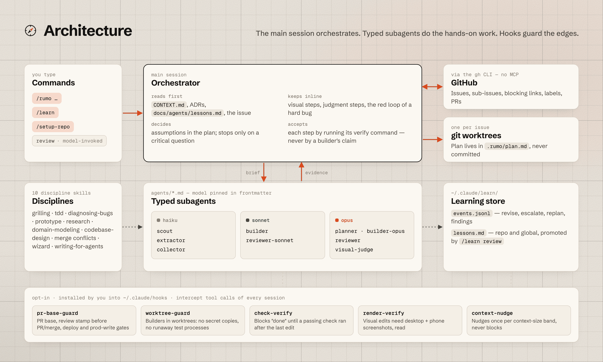
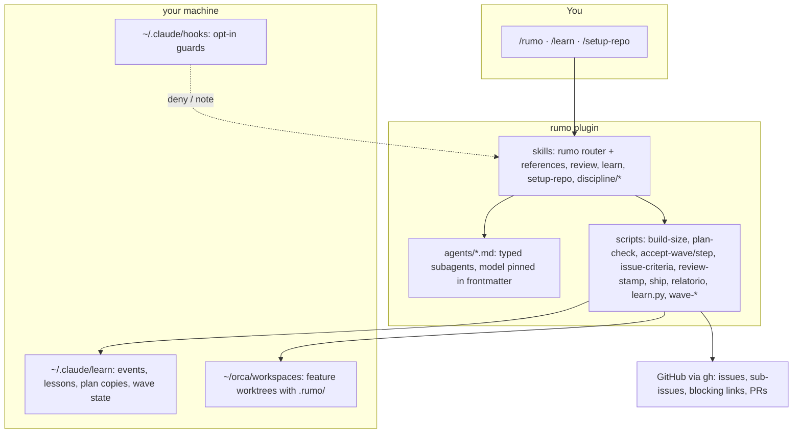

# Architecture and Design History

This page explains how rumo's pieces fit together at runtime and why they look the way they do. The architecture is a plugin that contributes skills (the `/rumo` router and its references, `review`, `/learn`, `/setup-repo`, ten discipline skills) and typed subagents, plus a set of scripts that turn judgment calls into commands and opt-in hooks that enforce the irreversible boundaries. The history draws on the repo's design records (`docs/design/`), its ADR, its research note and `CHANGELOG.md`.

## Layers

| Layer | Holds | Why it is separate |
|---|---|---|
| Skills | the procedure, in prose an agent follows | they change behaviour; every behaviour change bumps the plugin version |
| Typed agents | narrow contracts with pinned models, tools and turn budgets | a dispatch without `model` lands on the right model; a lean typed agent starts with far less context than a general-purpose one |
| Scripts | every decision that can be a command: lane size, plan form, acceptance, criteria, stamp, ship, report line, events | "the lane comes from a command, not from you"; the orchestrator stops judging what a script can decide |
| Hooks | denies for what has no undo | prose can be skipped; a `PreToolUse` deny cannot, even with permissions bypassed |
| GitHub | the durable record | the issue is the truth; plans are ephemeral |

## Design goals

From the 0.3 design record (`docs/design/0.3-orchestrator.md`), in tie-break order:

1. **Quality**: nothing ships without proof.
2. **Economy**: the expensive model only where it decides the outcome.
3. **Speed**: parallel when it is safe.

The premises that shaped the orchestrator came from measurements reported by a prior analysis of another subagent toolkit (one operator, mixed causes, "a direction, not a promise"): cache re-reads dominate token cost, so cost scales with context size times requests and a lean main session is the biggest lever; a lean typed agent starts with about 20k of context against about 80k for `general-purpose`; and assigning model and effort per role cut cost per task sharply while serious findings per change fell.

What the design explicitly does **not** copy: merging straight into main, a self-declared `Reviewed-by` trailer, a post-review fix with no re-review, an unsupervised "allow everything" permission gate, and agent twins with no difference in behaviour.

## Design records

| Record | Date | Subject |
|---|---|---|
| `docs/design/0.3-orchestrator.md` | 2026-10-13 | The orchestrator over typed subagents, sonnet builders, tiered review, `/learn`, mechanical guardrails, expected cost by change size; later sections record implementation divergences, a 0.3.1 hardening pre-mortem and 0.4 additions. Where it differs from the code, the code wins. |
| `docs/design/0.8-bottlenecks.md` | 2026-10-28 | Measured bottlenecks from transcripts, events and PRs. Problems P1–P8: a self-declared review stamp (integrity), event schema drift in `learn.py stats`, a test gate counting PIDs instead of runs, false positives in `check-verify`/`render-verify`, visual work missing on the first try, review calibration and open findings, planner over-exploration and long main sessions, surface hygiene. Ends with user decisions D1–D5. |
| `docs/adr/0001-open-findings-from-reviewer-transcripts.md` | — | Open findings come from reviewer transcripts and close only through a fix reviewer's `RESOLVED`/`WITHDRAWN` or the owner's Waiver. Rejected: the orchestrator passing the open list as a flag, the script re-running proofs, a failed replay closing a major. |
| `docs/research/review-sonnet.md` | 2026-11 | Whether review axes could move to sonnet. The rule: zero blockers and zero majors missed in the sample. No axis passed, so only fix re-reviews outside the sensitive tier run on `rumo:reviewer-sonnet`. |

### Decisions from 0.8 that shaped today's behaviour

- **D2:** retire `/rumo audit` and `/rumo triage` (no uses in a month), keep `map`.
- **D3:** open minors become one Follow-up issue per PR: more issues in the tracker, nothing lost.
- **D4:** a `.claude/no-render-verify` marker for video projects and print documents.
- **D5:** normalize the event history (diff shown first) rather than only skipping bad lines; this became `learn.py normalize`.
- The standards axis returned to opus after a measured sonnet experiment.

## Version history highlights

From `CHANGELOG.md`:

| Version | Date | Highlight |
|---|---|---|
| 0.1.0 | 2026-08-21 | First release: `/rumo`, a review gate, `/learn`, `/setup-repo`, ten discipline skills ported from mattpocock/skills 1.2.3 |
| 0.2.0 | 2026-09-24 | GitHub through the `gh` CLI instead of an MCP server; plans become ephemeral; modes name the next command instead of firing it; `/rumo audit` added (later retired) |
| 0.3.0 | 2026-10-13 | Orchestrated `/rumo build` over typed subagents; tiered review; `/learn`; `accept-step.sh`; T0/T1/T2 with the drift stop |
| 0.4.0 | 2026-10-14 | Parallel clean-context review axes with replay and a stamp tied to `HEAD`; the issue as spec authority with `issue-criteria.sh` and `issue-trust.sh`; visual judge; fast path; ticketless build |
| 0.5.0 | 2026-10-17 | `rumo:extractor`; sonnet builders for low-risk steps, waves of five builders, sliced tasks |
| 0.6.0 | 2026-10-20 | `/rumo wave`; findings carry outcome, axis and model; `wt-gc` ENV state |
| 0.7.0 | 2026-10-23 | `plan-check.sh` with the Model rule; `rumo:collector`; one batched `learn.py event -` per build; fix re-reviews on `reviewer-sonnet` |
| 0.8.x | 2026-10-29 → 11-12 | The bottleneck program: evidence-backed stamp, Open findings and Waivers, security axis on the sensitive tier, run-based test slots, visual brief and `visual-lint`, Follow-up issues, `phases`, Mandato and Relatório, launch-prompt rule; `audit`/`triage` retired |
| 0.9.0 | 2026-11-12 | `accept-wave.sh`, `build-size.sh`, `inbox.py`, `ship.sh`; the decide-and-record gate |
| 0.10.0 | 2026-11-12 | Abuse cases first for push/merge/delete/hook steps, enforced as a floor by `plan-check` |
| 0.11.x | 2026-11-13 → 15 | `worktree-guard` reads Python heredocs by AST; wave fixes; abuse case defined in `CONTEXT.md` |
| 0.12.x | 2026-11-15 → 17 | Per-lane LSP plugins off and RAM-gated launches; the planner briefly moved to another model tier and returned to opus (0.12.4) |

## Recurring design moves

Reading the records and the changelog together, a few moves repeat:

- **Turn a judgment into a command.** Lane size, plan form, acceptance, criteria checks, the stamp, shipping and the report line each became a script once a model got them wrong often enough.
- **Never let a component vouch for itself.** Builders' claims are re-verified by `accept-step.sh`; reviewers run in clean contexts; the stamp requires reviewer transcripts; only a fix reviewer or the owner closes a major; launch prompts never carry owner authority.
- **Measure before moving a model tier.** The sonnet review experiment and the per-category first-try calibration in `/learn review` both gate a tier change on data.
- **Fail closed at irreversible boundaries, open elsewhere.** Hooks fail open on malformed input, except where a mistake can't be undone (merge-head verification, a Mandato that can't be checked, unreadable reviewer reports).

Next: [[FAQ and Troubleshooting]]
