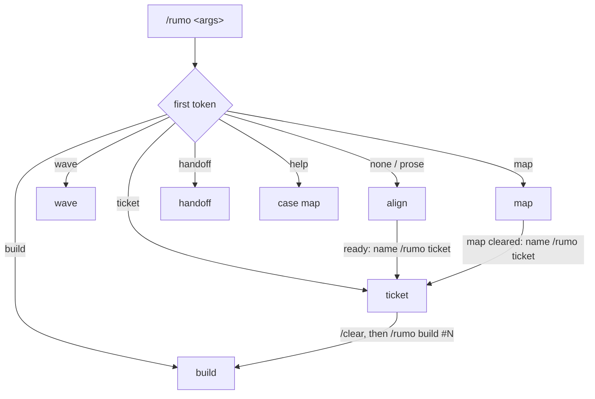

# Command: /rumo

`/rumo` is one router over six modes. It never does the work itself: it reads the first whitespace-separated token of its arguments, picks a mode, and follows that mode's reference file (`skills/rumo/references/<mode>.md`). With no token, or with text that matches no keyword, it runs **align**, the default mode that sharpens a raw idea by interview before anything gets built. This page covers the router and align; each other mode has its own page.

## Keyword table

| First token | Mode | What it does | Page |
|---|---|---|---|
| *(none)* or anything else | `align` | interview the idea (`grilling`) and capture terms and decisions (`domain-modeling`) in one unbroken window | this page |
| `ticket` | `ticket` | turn the aligned idea into one or more T1 GitHub issues | [[Mode ticket]] |
| `build` | `build` | orchestrate planner, builders, acceptance, review and ship for one T1, plan or ready text | [[Mode build]] |
| `wave` | `wave` | run several T1s at once, one worktree and one `/rumo build` session per issue | [[Mode wave]] |
| `map` | `map` | chart decision tickets for fog too big for one session | [[Mode map and handoff]] |
| `handoff` | `handoff` | write a portable continuation document | [[Mode map and handoff]] |
| `help` | case map | print the situation → mode → destination table; no mode fires | below |
| `audit` / `triage` | retired (0.8.x, 2026-10) | answers in one line: a finding becomes an issue via `/rumo ticket`; a standalone review runs the `review` skill | |

Bare `/rumo` with nothing to route prints the case map, the same as `/rumo help`.

The arrows between modes are commands you type; the router never fires one mode from another.

## align

### Mechanism

1. **Grill.** Run a `grilling` session against the idea: one question at a time, wait for the answer, act only once you confirm. Facts about the code are looked up, not asked: they go to `rumo:scout` (several questions batched into one dispatch), and only its `path:line` answers stay in the window. The decisions are yours.
2. **Capture as you go.** The moment a domain term firms up or a hard-to-reverse decision is made, `domain-modeling` writes it into `CONTEXT.md` or a new ADR. Not at the end of the session: a term that only lives in the chat is lost when the window clears.
3. **Repeat until ready**, or until you stop.

### Ready means all five hold

1. behaviour described from the user's side;
2. every acceptance criterion tagged `[cmd]` (a shell command with expected output), `[judgment]`, or `[visual]`, plus a whole-page `[visual]` criterion when a block joins a shared page;
3. out of scope named;
4. risk answered: does it touch money, auth, data, security, or prod (no / which);
5. new terms already in `CONTEXT.md`.

Then align names `/rumo ticket` for you to type. It never publishes the issue itself.

### One unbroken window

Grilling and domain capture happen in a single context window. No `/clear` or `/compact` between questions, between a question and its ADR write, or at any point before `ticket` publishes. Every answer builds on the reasoning that produced the last one.

### When a question needs running code

Some questions can't be settled by talking (a state model that only shows its shape when it runs, a UI you have to see). Align detours instead of theorizing:

1. `handoff` out, naming exactly the question at stake;
2. a fresh session runs `prototype` against that file to answer that one question with throwaway code;
3. `handoff` back, referenced from the original align thread, and grilling resumes there.

The align window never grows a prototype inline.

### Closing lines

| Situation | Line |
|---|---|
| mid-interview | `NEXT: keep-open until ticket publishes` |
| you stopped without publishing | `NEXT: clear` |
| detouring through a prototype | `NEXT: keep-open until handoff returns` |

## help: the case map

`/rumo help` prints a table from `skills/rumo/references/help.md`: one row per situation, the mode it routes to, and who does the work. A few representative rows:

| Situation | Mode | Who / destination |
|---|---|---|
| Vague idea, nothing built yet | `align` | conversation; `rumo:scout` for code facts |
| Idea sharpened, ready to be tracked | `ticket` | publishes a T1 |
| A T1 or a plan | `build` | `build-size.sh` picks the lane, then planner, builders, review, PR, merge on `dev` |
| Greenfield or huge feature, way not visible yet | `map` | decision tickets, hands off to `ticket` |
| Several ready T1s to build side by side | `wave` | one session per issue |
| "What is waiting on me?" | conversation | `python3 -I <rumo>/skills/rumo/scripts/inbox.py [--days N]` |
| Mistakes repeating | `/learn` | lessons ledger, promotion diffs you approve |

The case map is kept in sync with every behaviour change; a router that lies is worse than none.

Next: [[Mode ticket]]
