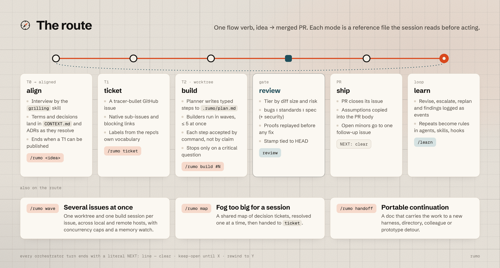
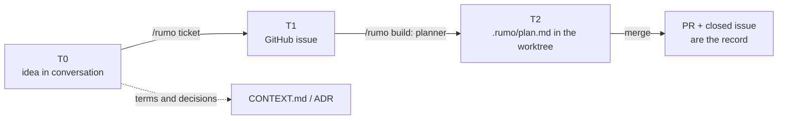

# Core Concepts

rumo rests on a handful of ideas that every mode shares: a three-tier work-item model (T0, T1, T2) with one-way promotion, plans that are deliberately ephemeral, a main session that orchestrates typed subagents instead of doing the work, a hard line between Critical questions and Assumptions, a literal `NEXT:` line at the end of every orchestrator turn, and a drift stop before any stale plan is built. This page defines each one and says where it is enforced.



## Work items: T0 → T1 → T2



| Tier | Lives in | Durable? | Notes |
|---|---|---|---|
| **T0** | the conversation | No. Its only durable residue is `CONTEXT.md` or an ADR, written the moment a term or decision resolves. | A trivial T0 (one file, ~30 lines) can be built inline without a ticket. |
| **T1** | a GitHub issue | Yes; the issue *is* the truth. | Tracer-bullet scope, native blocking links, labels from the repo's label vocabulary, criteria tagged `[cmd]` / `[judgment]` / `[visual]`. A T1 whose criteria are all judgment calls closes directly via `Closes #N` and is never promoted to T2. |
| **T2** | `<feature worktree>/.rumo/plan.md` | No. Never committed, gone with the worktree after merge. | Written by `rumo:planner` at the start of `build`. A copy goes to `~/.claude/learn/plans/<repo>-<slug>.md` so removing the worktree from the UI does not lose it. |

**Promotion is one-way and stamped on both sides.** When a plan is born from a ticket, the build comments `Plan: <path> (branch feat/<slug>)` on the issue and records `Planned at: <SHA>` and `Ticket-synced-at: <updatedAt>` in the plan. A ticket-born plan never opens a new issue.

A **ticketless build** is possible when free text already passes align's five readiness checks: the prose is saved as `<wt>/.rumo/spec.md`, which the review reads as the issue body.

## Plans are ephemeral

Plans are not a backlog. `.rumo/` is added to `.git/info/exclude` in each worktree (and `/setup-repo` adds it to `.gitignore`). After the merge the build removes the worktree, the branch and the plan copy. Plans left behind by PRs that stayed open are cleaned by `scripts/wt-gc.sh --apply`, which is yours to run.

## The orchestrator and typed subagents

In `build` the main session is the **orchestrator**: it plans through `rumo:planner`, dispatches builders, accepts each step with a command, and runs the review gate. It keeps its own context thin (briefs, reports, `--stat`, command results) and leaves full diffs to reviewers.

| Agent | Model | Does |
|---|---|---|
| `rumo:scout` | haiku | codebase facts with `path:line` |
| `rumo:extractor` | haiku | extraction from bulk (logs, transcripts, JSON, CI output) |
| `rumo:collector` | haiku | the same from the web, no shell |
| `rumo:planner` | opus, high effort | the plan: typed steps |
| `rumo:builder` | sonnet, high effort | a `Model: sonnet` step, or a precise `WORKTREE · TASK · FILES · VERIFY` brief |
| `rumo:builder-opus` | opus, medium effort | risky or under-specified steps, and any step a sonnet builder failed |
| `rumo:reviewer` | opus, high effort | bugs / standards / spec / security axes, and fix re-review on the sensitive tier |
| `rumo:reviewer-sonnet` | sonnet, high effort | fix re-reviews outside the sensitive tier |
| `rumo:visual-judge` | opus, high effort | visual steps, judged from screenshots, `design-taste` and the visual brief only |

Rules that hold everywhere:

- **No `model` parameter on a typed dispatch.** The model lives only in the agent's frontmatter; a parameter would override the pin.
- **Inline, never delegated:** visual steps (the render-verify hook and `design-taste` only see the main session), judgment steps, a trivial T0, and the red loop of `diagnosing-bugs`.
- **Slice every delegated task to one unit** sized for about 100 turns. A subagent pays its whole context on every turn, so several short runs beat one long one.
- Outside a build the same routing applies: a precise build brief goes to `rumo:builder`, bulk to `rumo:extractor`, web to `rumo:collector`, a lookup to `rumo:scout`. An untyped call is for research, diagnosis or judgment, with an explicit model.

Details per agent: [[Agents]].

## Critical questions vs Assumptions

A build runs start to merge without asking. It stops for the owner only on a **Critical question**: one where the wrong default cannot be taken back by a later commit, or where the answer would have to be invented.

| Critical (stops the build) | Not critical (decide and record) |
|---|---|
| a production deploy, a production DB write, deleting data, moving money, a message to a client or third party | naming, structure, library choice inside the stack |
| copying a real `.env` or any secret into a worktree | a seam's shape, test strategy |
| a value nobody wrote down: a price, a legal text, a credential, a provider or hostname | which of two reasonable UX readings |
| the issue contradicts itself or `CONTEXT.md` so two readings give different products | whether to go on, open the PR, or run the next fix round |
| a Waiver (only the owner may type `#waive`) | |

A Critical question is asked once, in one message, with the default the build would take and the cost of being wrong. Everything else is an **Assumption**: one line in the plan's `## Assumptions` (`<what was open> → <default taken> (<why>)`), copied verbatim into the PR body, where the owner reads it after the fact and reopens what they disagree with.

## The `NEXT:` contract

Every orchestrator turn of `/rumo`, `/setup-repo`, `review` and `/learn` ends its final message with exactly one literal line:

```text
NEXT: clear
NEXT: keep-open until <condition>
NEXT: rewind to <point>
```

When a worktree is in play, the merge happens **before** `clear`: committed-but-unmerged work is never left behind an emptied window.

## Context doctrine

- **Align is one unbroken window**, from the first question to the ticket publishing. No `/clear` or `/compact` in between.
- **Every build starts in a fresh window.** The optional `context-nudge` hook blocks `/rumo build` or `/rumo wave` typed into a window already above about 120k tokens.
- **Abandon a path with `/rewind`** (keeps the cached prefix), never `/compact` (throws the cache away). `/compact` is retired from the workflow.

## Drift stop

A plan written in an earlier session is checked on two axes before any builder runs:

```bash
git diff --stat <Planned at>..origin/<base> -- <all step Files>   # code axis
# issue axis: current updatedAt vs the plan's Ticket-synced-at
```

Either moved: the planner is re-dispatched with the old plan and the drift before anything is built. The review applies a related rule: a plan is **stale** (and not used as spec) when `git log <Planned at>..HEAD` has commits that no `Done:` line names.

## User-invoked vs model-invoked

`/rumo`, `/setup-repo` and `/learn` are user-invoked (`disable-model-invocation: true`): only a typed command fires them. When one mode leads into another, the session names the exact command ("type `/rumo ticket` here") and ends the turn. The single exception is `wave`, which starts `/rumo build` in the sessions it creates, for the issues its typed command names. `review` and the discipline skills are model-invoked.

## Hard boundaries

A build pushes, opens its PR and merges into `dev` by itself once stamped and green. A release into `main`/`master`, a production deploy and a production DB write happen only when the owner asked in the current session.

Next: [[Command rumo]]
