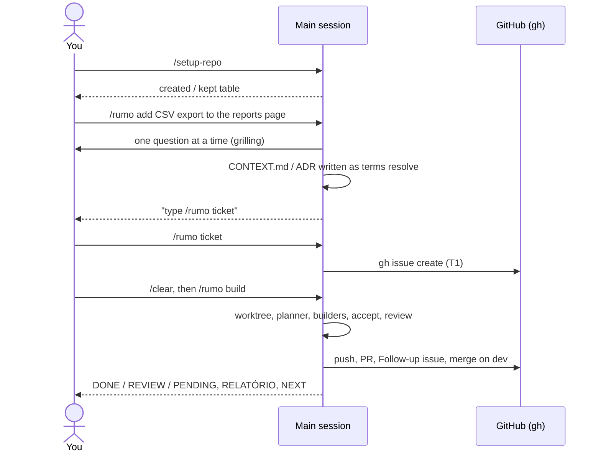

# Getting Started

This page takes you from nothing to a first merged change: what rumo expects on your machine, the two ways to install it, how to check the install, and a walkthrough of one idea going through `align`, `ticket` and `build`. It assumes you already use Claude Code day to day and have a GitHub repository you can push to.

## Prerequisites

| Requirement | Why | Check |
|---|---|---|
| Claude Code with plugin support | rumo is a plugin and marketplace; it ships skills and typed subagents | `claude --version`, `claude plugin --help` |
| `gh` CLI, authenticated | every tracker operation (issues, sub-issues, blocking links, PRs, merges) goes through `gh`; no GitHub MCP is used | `gh auth status` |
| `git` | worktrees, fixed-SHA review, the stamp | `git --version` |
| `python3` (3.9+, stdlib only) | `learn.py`, `relatorio.py`, `inbox.py`, `mandato.py`, several hooks | `python3 --version` |
| `bash` | the workflow scripts under `skills/*/scripts/` and `scripts/` | |
| `jq` | `pr-base-guard` fails open (allows) without it | `jq --version` |

Optional, by feature:

| Optional | Needed for |
|---|---|
| Node and Playwright | `visual-lint.sh`, the mechanical visual check before the visual judge. It uses the project's own Playwright first, else a pinned fallback through `npm exec`; with no usable node it exits with `visual-lint: env:` and the build goes on to the judge. |
| Orca and its `orca` CLI | `/rumo wave` only: it creates one Orca worktree and launches one Claude session per issue (`orca worktree create`, `orca agent launch`, `orca terminal …`). |
| macOS | parts of `wave` and the test-slot guard read macOS tools (`caffeinate`, `memory_pressure`, `sysctl`). Unknown memory makes the guard fall back to its lower limit. |
| A second machine reachable over `ssh` | remote wave lanes (see [[Mode wave]]). |

### Repository conventions rumo assumes

- **Integration branch `dev`.** Builds branch from `origin/dev` and `ship.sh` merges only into `dev`. A repo with no `dev` uses its documented base branch, else its default branch; a PR on any other base stays open for you, unless the repo's `CLAUDE.md` says a stamped PR merges into the default branch without asking (then the build passes `--merge-default-branch`).
- **Feature worktrees under `~/orca/workspaces/<repo>/<slug>`**, on `feat/<slug>` (or `fix/<slug>` for bugs). The `worktree-guard` hook scopes its rules to that root.
- **`origin/HEAD` set.** `/setup-repo` fixes a missing one with `git remote set-head origin --auto`.

## Install

### Option A — from GitHub, inside Claude Code

```text
/plugin marketplace add vkmtx/rumo-workflow
/plugin install rumo@rumo
```

The marketplace and the plugin are both named `rumo` (`.claude-plugin/marketplace.json` lists one plugin with `"source": "./"`).

### Option B — from a local checkout

```bash
git clone https://github.com/vkmtx/rumo-workflow.git rumo && cd rumo
./scripts/install.sh
```

`scripts/install.sh` does exactly three things:

1. `claude plugin validate <checkout>` (fails the script on an invalid manifest);
2. `claude plugin marketplace add <checkout>` (an "already added" error is ignored);
3. `claude plugin install rumo@rumo --scope user`.

It does **not** install the hooks. Those are opt-in and copied into `~/.claude/hooks/` by you; see [[Hooks]].

### Check the install

Open a session in any repository and type:

```text
/rumo help
```

It prints the case map (situation, mode, who does it) without firing any mode. If the command is unknown, the plugin is not installed or not enabled for this scope.

### Updating

Claude Code runs a cached copy of the plugin under `~/.claude/plugins/cache/rumo/`. A session reads new skill text only after the `version` in `.claude-plugin/plugin.json` changes and you run:

```bash
claude plugin update rumo@rumo
```

See [[FAQ and Troubleshooting]] if an edit "doesn't take".

## First run



### 1. Bootstrap the repo

```text
/setup-repo
```

It writes only what is missing and reports every existing file as `kept: <path>`: `docs/agents/issue-tracker.md`, `docs/agents/triage-labels.md`, `docs/agents/domain.md`, `CONTEXT.md`, `docs/agents/lessons.md`, and an `## Agent skills` block in `CLAUDE.md`. It also appends `.rumo/` to `.gitignore`. It never commits; you do. Details: [[Setup Repo]].

### 2. Align the idea

```text
/rumo add CSV export to the reports page
```

Free text (or a bare `/rumo` with nothing else) routes to **align**. The session interviews you one question at a time, sends code questions to `rumo:scout` instead of asking you, and writes each term or decision into `CONTEXT.md` or an ADR the moment it resolves. The idea is ready when five checks hold: behaviour from the user's side, every criterion tagged `[cmd]` / `[judgment]` / `[visual]`, out of scope named, risk answered, new terms in `CONTEXT.md`. Keep this one window open until the ticket publishes. Details: [[Command rumo]].

### 3. Publish the ticket

```text
/rumo ticket
```

It synthesizes only what the window already holds, never interviews, and publishes one T1 issue (or several tracer-bullet issues with native blocking links). Any risk adds the `risk:sensitive` label. Details: [[Mode ticket]].

### 4. Build it

```text
/clear
/rumo build #42
```

Every build starts in a fresh window. The build creates a worktree, sizes the lane with `build-size.sh`, dispatches the planner, runs builders in waves, accepts each wave by command, runs the tiered review, and ships: push, PR, Follow-up issue when something stays open, merge on `dev`, cleanup. It stops for you only on a Critical question. Details: [[Mode build]].

### 5. Read the close

Every build ends with:

```text
DONE: what shipped (commits, PR + merge state, tests passing)
REVIEW: which tier ran on which range
PENDING: what remains, what was not verified end-to-end
RELATÓRIO: {"estado":"ready","issue":42,"pr":"https://github.com/...","merged":true,"motivo":null,"pergunta":null}
NEXT: clear
```

The `RELATÓRIO:` (report) line is machine-readable for launchers; `NEXT:` tells you what to do with the window. See [[Core Concepts]].

Next: [[Core Concepts]]
