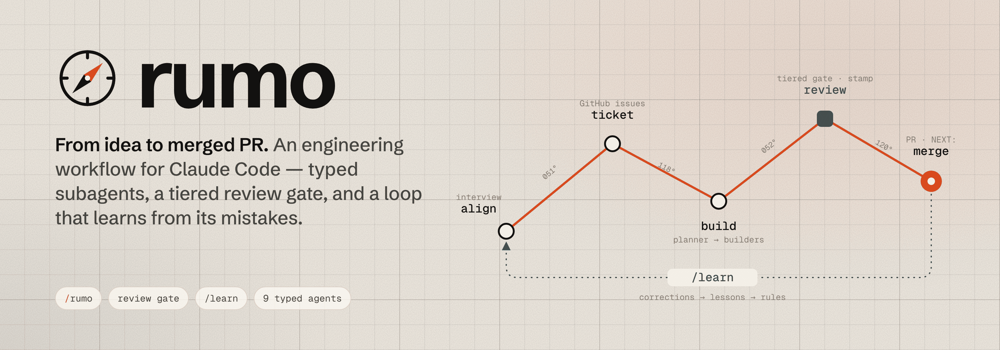
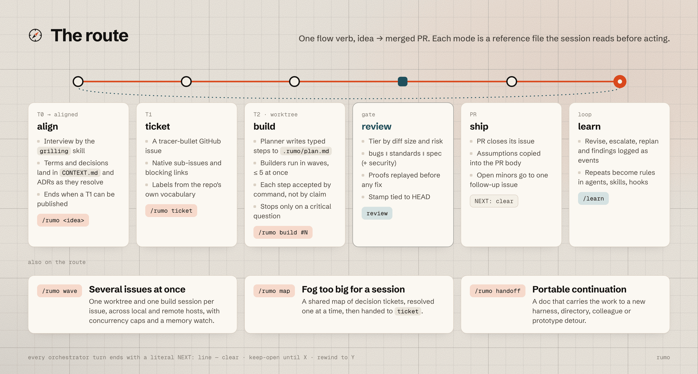
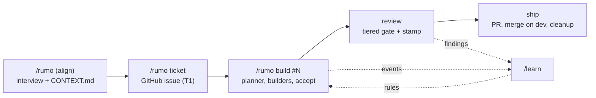

  <picture>
    <source media="(prefers-color-scheme: dark)" srcset="https://raw.githubusercontent.com/vkmtx/rumo-workflow/main/docs/assets/banner-dark.png">
    
  </picture>

# rumo

rumo is a Claude Code plugin, published as its own single-plugin marketplace, that routes engineering work from a raw idea to a merged pull request. One command, `/rumo`, sharpens the idea by interview, publishes it as a GitHub issue, and builds it: the main session acts as an orchestrator over typed subagents (planner, builders, reviewers, a visual judge), each pinned to a model in its own frontmatter. A tiered review gate writes a stamp tied to `HEAD`, and `/learn` turns repeated mistakes into rules. It is designed for a solo operator who works through the `gh` CLI.

## What you get

| Piece | Kind | One line |
|---|---|---|
| `/rumo` | user-invoked command | One router over six modes: `align` (default), `ticket`, `build`, `wave`, `map`, `handoff`, plus `help` |
| `review` | model-invoked skill | Tiered pre-PR gate (light / standard / sensitive) with independent axes and a review stamp |
| `/learn` | user-invoked command | Harvest a session, record a lesson, or promote repeated lessons into approved diffs |
| `/setup-repo` | user-invoked command | One-pass, additive bootstrap of a repo's `CONTEXT.md`, `docs/agents/*` and `CLAUDE.md` block |
| 9 typed subagents | `agents/*.md` | `scout`, `extractor`, `collector` (haiku); `planner`, `reviewer`, `builder-opus`, `visual-judge` (opus); `builder`, `reviewer-sonnet` (sonnet) |
| 10 discipline skills | model-invoked | `grilling`, `tdd`, `diagnosing-bugs`, `prototype`, `research`, `domain-modeling`, `codebase-design`, `resolving-merge-conflicts`, `wizard`, `writing-for-agents` |
| Staged hooks | opt-in, `scripts/hooks-staged/` | Mechanical guards for PR/merge, worktrees, test concurrency, verification and context size |

## The flow in one picture

## Design stance

- **The issue is the truth.** Plans are ephemeral files inside the feature worktree and die with it after merge; the PR and the closed issue are the record.
- **Accept by command, not by claim.** Every builder step is accepted only when its Verify command passes, runs tests, and goes red on an assertion without the step's code.
- **Expensive models only where judgment decides.** Haiku extracts, sonnet builds from a precise spec, opus plans, reviews and judges.
- **Ask only Critical questions.** A build stops for the owner only when a wrong default could not be taken back by a later commit, or when the answer would have to be invented. Everything else becomes a recorded Assumption.
- **User-invoked commands fire only when typed.** A mode that leads into another names the command for you to type.

## Where to start

1. [[Getting Started]] — prerequisites, install, a first run.
2. [[Core Concepts]] — the vocabulary every other page uses.
3. [Command: /rumo](Command-rumo) and the mode pages.
4. [[Review Gate]], [[Learn]] and [[Hooks]] for the guarantees around the build.

All other pages are listed in the sidebar.

Next: [[Getting Started]]
