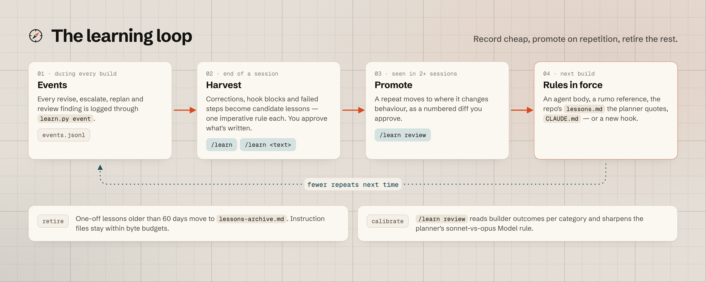
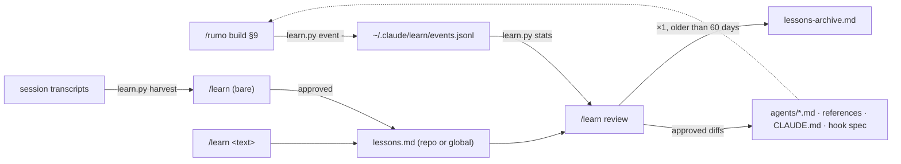

# Learn

`/learn` keeps the setup improving on a simple rule: **record cheap, promote on repetition, retire the rest**. Builds log structured events (revise, escalate, replan, block, scope, finding, run) through `learn.py`. `/learn` harvests a session's corrections, hook blocks and failures into candidate lessons, records a single lesson on request, and in `review` mode promotes lessons seen in two or more sessions into the agent, skill, `CLAUDE.md` or hook where they change behaviour. Every promotion is a diff you approve; `/learn` never rewrites an instruction file on its own.





A **lesson** is one imperative rule that would have prevented a real, observed mistake.

## Where lessons live

| Scope | File | Read by |
|---|---|---|
| Repo (about this codebase) | `<repo>/docs/agents/lessons.md`, committed | `rumo:planner` (quotes relevant lessons into steps), the standards reviewer |
| Global (about how you work) | `~/.claude/learn/lessons.md` | `/learn review` |
| Raw events | `~/.claude/learn/events.jsonl`, rotated monthly to `events-YYYYMM.jsonl.gz`; written only through `learn.py event` | `learn.py stats` |
| Retired | `lessons-archive.md` beside each `lessons.md` | nobody, by default |

Entry format, one line:

```text
- L<n> · <YYYY-MM-DD> · ×<count> · <imperative rule> — why: <the mistake, one line> · seen: <issue/PR/session/event>
```

Every write to a `lessons.md` is followed by `learn.py scan <file>`; exit 1 means a line looks like a secret and must be redacted.

## Three modes

### `/learn`: harvest this session

1. `learn.py harvest --current --cwd "$PWD"` (or `--days 1` for "today") scans transcripts for user corrections (with the assistant text they answered), interrupts, hook blocks and repeated tool failures. Correction detection matches Portuguese and English phrasing; it only proposes candidates, and the model judges them.
2. Only signals that point at a **mistake with a cause** survive: a correction, a hook stop, a failed step, a rejected tool call. Questions, steering and preferences already written down are dropped.
3. Each survivor becomes a candidate (rule, why, seen, scope: repo or global). A match for an existing lesson bumps its `×count`.
4. Candidates are shown as a numbered table; only what you approve is written.

### `/learn <text>`: record one

Your text is rewritten as one imperative entry, scoped, shown, and written on a yes.

### `/learn review`: promote, calibrate, retire

1. **Gather:** `learn.py stats --days 30`, `learn.py spend --days 7`, `learn.py phases --days 14`, both `lessons.md` files, and `learn.py harvest --days 14`. If `stats` reports malformed lines, `learn.py normalize` writes a normalized copy plus a dated backup; the log is replaced only on your yes.
2. **Promote** every lesson seen in **two or more distinct sessions** (`×count` counts sessions, not lines), and every repeated cause in `stats`, to the most specific place that would have prevented it:

   | The rule is about… | Promote into |
   |---|---|
   | how a builder, planner or reviewer works | that agent's body (`agents/*.md`) |
   | a rumo step (plan, ticket, review gate) | the matching `skills/rumo/references/*.md` or `plan-template.md` |
   | this repo's code or commands | stays in the repo `lessons.md`; promotion sharpens its wording |
   | visual taste | the `design-taste` skill's consolidated lessons |
   | an always-true working preference | `~/.claude/CLAUDE.md` |
   | something mechanical a script can check | a hook spec (event, matcher, what it blocks, test cases), built after approval |

   `writing-for-agents` is loaded before drafting. All promotions are shown together as numbered diffs; only approved ones are applied. Promoted lessons leave a pointer line in the archive.
3. **Calibrate the Model rule** from `stats`' "Calibration candidates" only (n ≥ 5 per category, environment failures excluded): sharpen the planner's brief for a weak category, or route it to opus; an opus category at ≥ 90% first-try may be proposed for sonnet.
4. **Reviewer habits:** a finding pattern dismissed three or more times becomes a proposed line in `agents/reviewer.md` to stop raising it; a pattern fixed three or more times becomes a repo lesson so the planner prevents it.
5. **Retire** `×1` lessons older than 60 days to the archive.
6. **Budget and secrets:** `learn.py budget` on the instruction files a promotion touched (defaults: `CLAUDE.md` 32 KB, `SKILL.md` 8 KB, `agents/*.md` 6 KB, `lessons.md` 8 KB, anything else 16 KB), then `learn.py scan` on both lesson files.
7. If rumo's own source changed: bump `version` in `.claude-plugin/plugin.json` and run `claude plugin update rumo@rumo`.

`review` closes with a five-line report (promoted, calibrated, retired, budget status, the costliest pattern and the top line of `spend`), then the `phases` block verbatim.

## Events

A build writes all its events in **one call**, the `run` line last. All lines are validated before any is written; a rejected batch is fixed and re-sent whole.

```bash
python3 -I <rumo>/skills/learn/scripts/learn.py event - <<'EOF'
{"repo":"app","issue":42,"kind":"escalate","step":2,"model":"sonnet","category":"api","why":"<gist of the failing output>","files":["src/x.ts"]}
{"repo":"app","issue":42,"kind":"finding","severity":"major","outcome":"fixed","axis":"bugs","model":"opus","category":"api","why":"<the finding in one line>","files":["src/x.ts"]}
{"repo":"app","issue":42,"kind":"run","steps":{"sonnet":3,"opus":2,"orchestrator":1},"first_try":{"sonnet":2,"opus":2,"orchestrator":1},"by_category":{"api":{"sonnet":{"steps":3,"first_try":2}}},"findings":{"blocker":0,"major":1,"minor":0,"question":0}}
EOF
```

| Field | Rule |
|---|---|
| `kind` | `revise · escalate · replan · block · scope · finding · run` |
| `category` | required on every line except `run`: `test · ui-logic · api · db-migration · data-model · config · build-tooling · refactor · integration · auth · perf · docs · visual · other` |
| `model` | `opus · sonnet · haiku · orchestrator` (`opus` is the key for the whole judgment tier) |
| `severity` (finding) | required: `blocker · major · minor · question` |
| `outcome` (finding) | required: `fixed · dismissed · open` |
| `reason` (dismissed only) | required: `pre-existing · by-design · owner-waived · wrong · unreplayed` |
| `axis` (finding) | `bugs · standards · spec · security · fix · visual` |
| `env` | `true` when the environment failed (missing service, flaky infra, OOM), so calibration stays honest. A red CI is logged as a revise with `"env": true`. |
| `steps`, `first_try` (run) | `{model: n}` objects, `first_try` ≤ `steps` per model |
| `by_category` (run) | keys are the Category, `<Category>/risk` for steps with Risk ≠ `none` (kept out of calibration), or `visual` for visual steps |

`learn.py event` stamps `ts`, redacts secrets, and rotates the file monthly.

## `learn.py` reference

| Subcommand | Does |
|---|---|
| `harvest [--current \| --session ID \| --days N] [--cwd DIR] [--root DIR]` | learning signals from transcripts |
| `stats [--events FILE] [--days N]` | rungs per kind, first-try rate per model and category, top causes and files, dismissals by axis × reason |
| `event '<json>' \| - [--events FILE]` | validate, scrub and append events |
| `normalize [--events FILE] [--out FILE]` | one-off history fix into a separate file, with backup; never modifies the source |
| `scan FILE …` | exit 1 when a line looks like a secret (prints `file:line` only) |
| `spend [--days N] [--root DIR]` | token spend: main session vs subagents, main session's share above 300k context, subagents by type × model |
| `phases [--days N] [--root DIR]` | wall-clock of each build: critical path, phases, builder concurrency, review rounds, stalls, owner touches; wave orchestrators and launcher messages counted apart |
| `budget FILE[:LIMIT_KB] …` | byte budget check |

`learn.py` makes no model calls. Every `/learn` turn ends with the `NEXT:` line.

Next: [[Setup Repo]]
