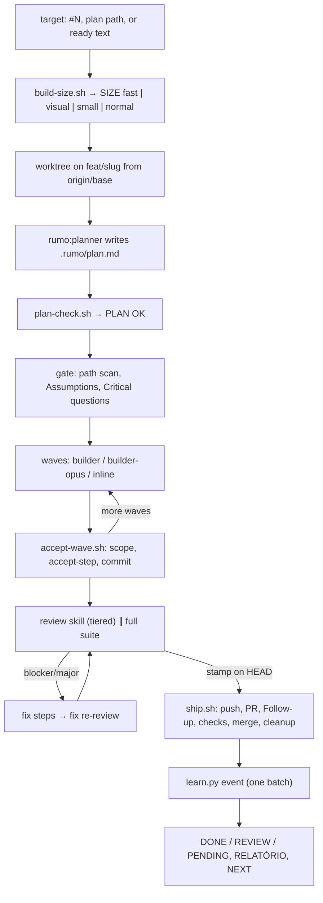
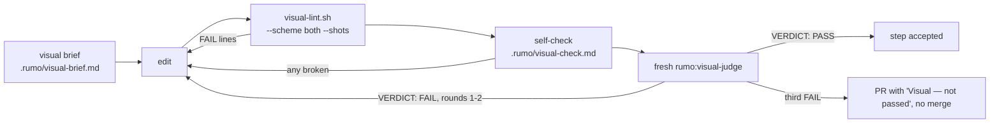

# Mode: build

`/rumo build <target>` turns an aligned work item into shipped code, and it is the only `/rumo` mode that writes source. The main session is the orchestrator: it creates a feature worktree, has `rumo:planner` write typed steps, dispatches builders in waves by each step's `Model`, accepts every wave with a command rather than a builder's claim, runs the tiered review, and ships (push, PR, Follow-up issue, merge on `dev`, cleanup) without asking. It stops only on a Critical question, and it logs one batch of events for `/learn` before it closes.



Every build starts in a **fresh window**: if the align phase that produced the target is still open, `/clear` first.

## 1. Target and lane

| Target | Resolution |
|---|---|
| **T1** (`#42` or an issue URL) | `gh issue view <N> --json title,body,comments,labels,updatedAt,url` |
| **Plan path** (`<wt>/.rumo/plan.md`, or its copy in `~/.claude/learn/plans/`) | resume: the worktree must be clean outside `.rumo/`, steps with `Done: <sha>` are skipped, then the drift stop |
| **Free text** | trivial → inline lane; already ready by align's five checks → ticketless build with `<wt>/.rumo/spec.md` as the spec; anything fuzzier → back to `/rumo` (align) |

**The lane comes from a command, not from judgment.** The issue JSON is saved and `build-size.sh <issue.json>` prints one line:

| Output | Meaning | Route |
|---|---|---|
| `SIZE fast` | at most 2 criteria, all `[cmd]`, no risk | no planner: the orchestrator writes a one-step plan in the template's shape (with `Planned at:` and `Issue:`), then builder or inline |
| `SIZE visual` | no `[cmd]` criterion | no planner (it would only write orchestrator steps); inline |
| `SIZE small` | small issue | planner with `SIZE: small`: at most 2 steps, 8000 characters, `plan-check.sh --small` |
| `SIZE normal` | everything else | planner, normal limits |

A fast-lane step that turns out to need more than 2 files or about 150 lines gets the planner after all.

## 2. Inline lane

Some work runs only in the main session, with `tdd` at agreed seams and `review` at the close:

- a **trivial T0**: one clear file, one clear change, about 30 lines or fewer;
- **visual steps** (`Type: visual`): the render-verify hook and `design-taste` only see the main session;
- **judgment steps** (`Type: judgment`): "done" is the orchestrator's call, recorded under Assumptions;
- **hard bugs**: `diagnosing-bugs` needs its red loop in hand; once the loop is red and the fix is specified, the fix itself can go to a builder.

Inline work on a T1 still happens in the feature worktree.

### The visual pipeline



1. **Visual brief before the first visual edit.** Load `design-taste` (and `dataviz` for metrics, charts or dashboards), then write `.rumo/visual-brief.md` with Purpose, Content inventory, Dominant element, Reference (an absolute path to a local image, or `none given` recorded as an Assumption) and the Rules that apply, each quoted with its source.
2. **Lint and shoot in one command:** `visual-lint.sh --project <wt> --scheme both --shots <wt>/.rumo/shots <url>`. At 390 px with touch and at 1440 px it checks touch targets ≥ 44 px (390 only), no horizontal scroll, an opaque sticky header with nothing under it, no unstyled native `select`/date/time control, no clipped text, and text contrast (4.5:1; 3:1 for large text). It then saves one full-page image per viewport and scheme (`SHOT <path>`). Exit 1 prints `FAIL <rule> @<viewport> <element> — <detail>`; a lint failure never spends a judge run.
3. **Self-check:** one line per brief rule, per inventory block and for the dominant element, `ok — …` or `broken — …`. The judge is dispatched only when every line reads `ok` on shots newer than the last edit.
4. **Independent judge:** `rumo:visual-judge` gets only the shot paths, the `design-taste` path, the visual brief path and the issue's `[visual]` criteria quoted. Its last line is `VERDICT: PASS` or `VERDICT: FAIL`. After a FAIL a **fresh** judge is dispatched, never the same one resumed. A third FAIL ends the step as not passed: the PR opens with the judge's FAIL lines under **Visual — not passed**, skips the merge and ends `waiting`. Your own rejection still wins over a judge's PASS.

A visual complaint about what this build just delivered is a fix in this build (its rule goes into the brief); it becomes a new ticket only when it asks for new scope.

## 3. Plan

### Worktree

```bash
git -C <repo> fetch origin <base>
git -C <repo> worktree add --no-track -b feat/<slug> ~/orca/workspaces/<repo>/<slug> origin/<base>
grep -qx '.rumo/' <repo>/.git/info/exclude || echo '.rumo/' >> <repo>/.git/info/exclude
```

Base is `dev`; without `dev`, the repo's documented base, else its default branch. `--no-track` keeps a bare `git push` from landing on the base. Dependencies are installed once here; builders share the tree and never install. A session already inside a worktree for this issue (launched by `wave`) uses it and renames the branch to `feat/<N>-<slug>` before the first commit.

**Env:** the worktree gets a `.env.local` with only what differs (local DB, slot port). Copying the main checkout's real `.env` is a Critical question, asked only when a step cannot run without real keys.

### Planner

`rumo:planner` is dispatched with the issue JSON, `PLAN PATH`, `TEMPLATE` (`references/plan-template.md`), `CHECK` (`scripts/plan-check.sh`), `REPO`, optional `FACTS ALREADY KNOWN` and optional `SIZE: small`. While it runs (it only reads), the orchestrator starts in the background what never depends on the plan: the lockfile install, a baseline typecheck of the untouched tree, and the dev server for a UI issue.

The planner returns `PLAN · STEPS · WAVES · RISK · SEAMS · OPEN QUESTIONS`. The plan is copied to `~/.claude/learn/plans/<repo>-<slug>.md` immediately.

Each step carries nine fields:

| Field | Values |
|---|---|
| Files | exact paths, `(create)` for new ones |
| Does | exact behaviour, symbols named |
| Test first | the cases that go red first; for `Risk: security`, abuse cases before `happy:` |
| Verify | `` `<command>` → <expected output> `` |
| Type | `cmd` · `visual` · `judgment` |
| Risk | `none` · `money` · `auth` · `data` · `security` · `prod` |
| Category | `test` · `ui-logic` · `api` · `db-migration` · `data-model` · `config` · `build-tooling` · `refactor` · `integration` · `auth` · `perf` · `docs` · `other` |
| Parallel with | steps with disjoint Files and no dependency, or `—` |
| Model | `sonnet` · `opus` · `orchestrator`, with the reason |

At most six steps, each about 150 changed lines or fewer; the plan stays around 20k characters (24000 hard limit).

### The Model rule

The single source is `agents/planner.md`:

> `sonnet` only when all four hold: (1) Files names every path, (2) Does leaves no decision open, (3) Verify is a command with an expected output, (4) Risk is `none`. Any miss → `opus`.

- A step that misses (2) only because a naming, structure or approach choice is open is not an opus step: the planner makes the choice and writes it into Does.
- `Type: visual` or `judgment` → `Model: orchestrator`.
- An opus step cites every failed condition by number (`Model: opus — (4) auth`); any Risk is always `(4)`.
- A category's first-try rate never moves a risky step to sonnet.

**Abuse cases first.** A step whose code pushes, merges, deploys, deletes files, runs a command built from input, or that a hook must see is `Risk: security`. Its Test first lists four labels before `happy:`, each with a case or `n/a — <why>`: `hook:`, `third-party input:`, `check-to-use:`, `deletion:`. See [[Glossary]] (Abuse case).

### plan-check

`plan-check.sh [--small] <plan>` checks form, not content: the nine fields, plain Files paths, Verify as a command with expected output, the Model rule, **Rule A** (a step naming a push/merge/deploy/delete/shell command, or touching a hook dir or hook config, is `Risk: security`), **Rule B** (a security step lists all four abuse labels), at most six steps (two with `--small`), disjoint Files between parallel steps, and size. `PLAN FAIL` lines go back to the same planner. A planner reply starting `STEPS: NOT SMALL` drops the small limits; that is not a Critical question.

## 4. Gate: decide, record, go on

The review's path scan runs over the union of every step's Files; a hit on a step marked `Risk: none` counts as risk. SEAMS, RISK and OPEN QUESTIONS from the planner are **Assumptions**: the recommended default is taken and one line per item goes into `## Assumptions`. Only a **Critical question** stops the build (see [[Core Concepts]]). Before asking, the build sets its Orca card to `BLOCKED: question — <one line>` and ends `waiting` with the question in the Relatório. An unattended run (no human) applies the same rule and ends `BLOCKED: question`.

## 5. Build in waves

Waves come from the planner's WAVES line (`[1] → [2,3] → [4]`) and run in order.

| Step `Model` | Dispatched to |
|---|---|
| `sonnet` | `rumo:builder` |
| `opus` | `rumo:builder-opus` |
| `orchestrator` | inline in the main session |

- **Parallel:** every builder of a wave in one message, **5 at most**. They share the feature worktree because their Files are disjoint. A step whose Verify needs a database, a dev server or a fixed port runs in a wave of its own.
- **Test slots:** the optional `worktree-guard` hook caps test runs machine-wide at 3 logical runs when free memory is 30% or more, else 2 (`RUMO_MAX_TEST_RUNS` sets an exact limit), and waits up to about 50 s for a slot before it denies.
- **New dependencies** arrive as a `Model: orchestrator` step installed inline between waves.
- **Model limit fallback:** a typed agent that dies on a usage limit is re-dispatched at once with the same brief: builder or planner → `general-purpose` with `model: "opus"`; reviewer → `rumo:reviewer-sonnet`; visual judge → `general-purpose` with `model: "opus"` and the judge's brief. The fallback is named under Assumptions.

The builder brief is short; the builder reads the rest from disk:

```text
WORKTREE: <abs path>
PLAN: <abs plan path> — execute Step <n> only.
COMMANDS: see the plan's "Commands you will need".
PARALLEL: steps <m,…> are being built concurrently in other files of this worktree.
ISOLATION: PORT=<base+n> TEST_DB=<name>_<n>   (only when steps touch a server or DB)
FAILURE NOTES: <only on escalation>
```

## 6. Accept each wave, by command

After every builder of the wave reports:

```bash
bash <rumo>/skills/rumo/scripts/accept-wave.sh <wt> <plan> --copy <plan copy> '<n>=<commit message>' ['<m>=…']
```

Per step it checks, then acts:

1. **Scope:** every changed or untracked path belongs to exactly one named step's Files. An extra or shared path, or an ignored `.env*` created after the plan, prints `WAVE FAIL scope <path>` and nothing is accepted.
2. **Accept** through `accept-step.sh`: the Verify passes, runs more than zero tests, was not won by weakening tests, and goes **red on an assertion** with the step's code removed. A builder's `RED→GREEN` line is a claim; this is the evidence.
3. **Commit by path** and append `- Done: <sha>` to the plan and its copy.

Output is `STEP <n> ACCEPT OK <sha>` or `STEP <n> ACCEPT FAIL: …`. Between waves the repo's typecheck and the test files of every accepted step run; after the last wave the full suite and typecheck start in the background beside the review.

### Rejection ladder and escalation

| Rung | Action |
|---|---|
| 1. revise | SendMessage to the same builder (warm cache): the failing command and output only. Once. |
| 2. escalate | fresh `rumo:builder-opus` with `FAILURE NOTES`. A failed sonnet step never goes back to sonnet. |
| 3. replan | the planner rewrites the step (or the plan) from both failures |
| 4. block | the build stops `failed`, with what failed, what was tried and the planner's read |

Before a rung that restarts a step, only that step's Files are reset; siblings' files stay.

## 7. Review and fix rounds

The `review` skill runs with fixed point `origin/<base>` and the code untouched; see [[Review Gate]]. Only findings that survived replay become fix steps, written in the plan's step format and routed by the same Model rule. **Minors and questions never open a round:** they are fixed inline (under 30 lines, `--fix --inline-fix`) or go to the PR body and the Follow-up issue. Rounds continue without asking while each closes at least one Open finding, up to four; a round that closes none, or a fourth that leaves one open, blocks the build. An unattended run whose stamp is refused opens no PR and ends `BLOCKED: open finding <ids>`.

## 8. Ship

**Mandato first.** `mandato.py check <wt>` reads the host-written Mandato (mandate) if one exists: `valid alcance=pr` stops after the PR, `alcance=merge` goes on, `refused` ships nothing and ends `BLOCKED: mandato <reason>`, `absent` falls back to the launch prompt's `AUTHORIZED:` line. See [[Mode wave]].

Then one call:

```bash
bash <rumo>/skills/rumo/scripts/ship.sh <wt> --base <base> --issue <N> --title "<title>" \
  --body-file <wt>/.rumo/pr-body.md [--followup-file <wt>/.rumo/followup.md] \
  [--slot-env <file>] [--no-merge] [--merge-default-branch]
```

It prints one `SHIP <step> ok|fail|skip` line per step and stops at the first fail:

1. push `feat/<slug>` and `gh pr create --base <base>`. The PR body holds the summary, `Closes #<N>`, the **Assumptions** verbatim, a step × model × first-try table, review findings and how each was handled, and **Visual — not passed** when applicable.
2. the **Follow-up issue**, when minors, questions or Waivers stay open (`Follow-up #<PR>: <PR title>`; the PR body gets `Follow-up: #<issue>`, a plain reference the merge does not close).
3. **merge**, when the base is `dev` (or the default branch with `--merge-default-branch`), the PR's checks are green (no checks configured counts as green), no visual step ended not passed and no Critical question is pending. Before merging, the base-merge sequence runs (see [[Review Gate]]). A failing line leaves the PR open and the build ends `waiting`.
4. **cleanup** after the merge: remove the worktree, delete the branch, `git fetch --prune`, delete the plan copy and slot resources. A worktree holding an env file the main checkout lacks is kept (`SHIP cleanup skip`) for `wt-gc.sh --apply --with-env`.

Red CI on the PR goes to `rumo:extractor`, which reads `gh run view <id> --log-failed` and returns job, step, test and first error line. `SHIP … BASE MOVED` triggers the base-merge sequence and a rerun.

Always the owner's: a PR into `main`/`master` of a repo that integrates in `dev`, any production deploy, any production DB write. A headless run (`claude -p`) is denied `gh pr create` by the hook and ends with the PR body and Follow-up text.

## 9. Learn, then close

Before closing, one `learn.py event -` call writes every event of the build as JSON lines (the `run` line last; all validated before any is written). Event kinds: `revise · escalate · replan · block · scope · finding · run`. See [[Learn]] for the schema. When the build logged any revise, escalate, replan, block or finding, it prints up to three lesson candidates and points at `/learn`.

The close is fixed:

```text
DONE: what shipped (commits, PR + merge state, tests passing)
REVIEW: which tier ran on which range
PENDING: what remains, what was NOT verified end-to-end
RELATÓRIO: {"estado":"...","issue":N,"pr":...,"merged":...,"motivo":...,"pergunta":...}
NEXT: clear | keep-open until <X> | rewind to <Y>
```

| Ending | Relatório `estado` |
|---|---|
| merged and cleaned up | `ready` (with `--merged`) |
| PR open and a merge line failed, or a Critical question | `waiting` (with `--pergunta`) |
| any other `BLOCKED: <x>` | `blocked` (`--motivo` such as `gate`, `lint`, `judge`, `open-finding`, `mandato`) |
| tests or CI red past the ladder | `failed` (`--motivo tests` / `ci`) |
| path abandoned | `dropped` |
| review still running | `progress` |

The line is printed by `relatorio.py emit`, never hand-written.

Next: [[Mode wave]]
