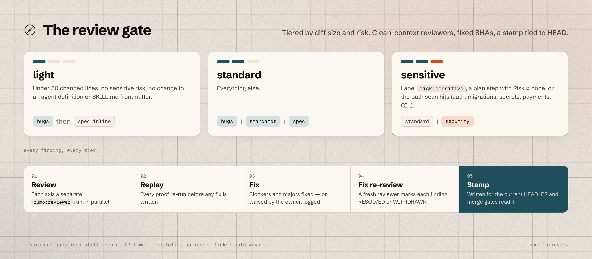
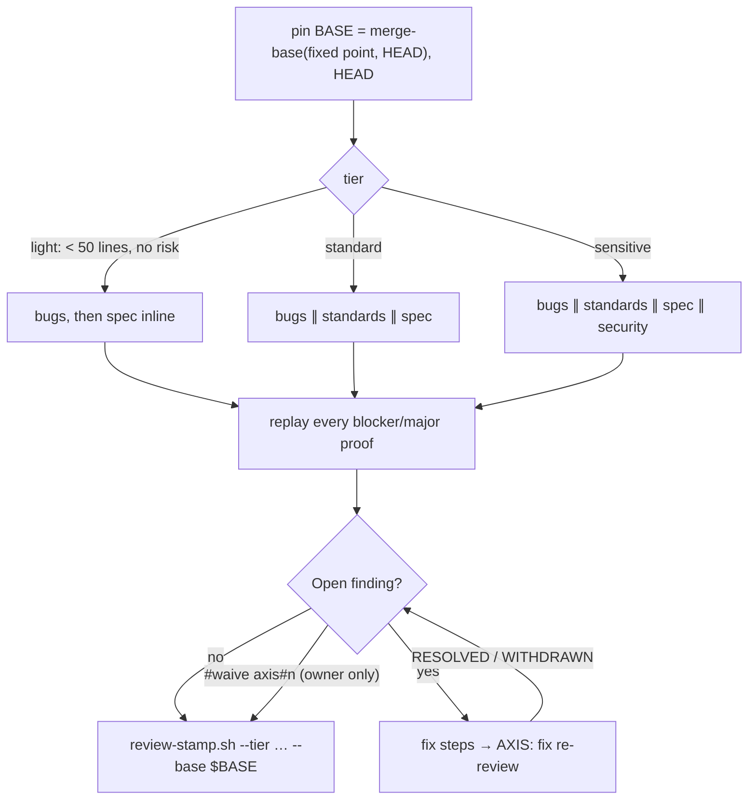

# Review Gate

The `review` skill is rumo's pre-PR gate. It pins a fixed range (`BASE..HEAD` SHAs), picks a tier from the diff's size, its paths and its risk, and dispatches independent axes (bugs, standards, spec, and security on the sensitive tier) as clean-context `rumo:reviewer` runs in parallel. Blocker and major findings are replayed before anyone fixes anything. The result is a **stamp**, written only by `review-stamp.sh`, that ties the review to the current `HEAD`. The stamp is refused while any **Open finding** remains. `review` is model-invoked: it runs at the close of every build, before any PR, or when you ask for a review of a branch or diff.





## 0. Range and tier

The fixed point is whatever you name (SHA, branch, tag, PR); unstated, it is `origin/dev`, or `origin/HEAD` in a repo without `dev`. Every axis gets `BASE=$(git merge-base <fixed-point> HEAD)` and `HEAD=$(git rev-parse HEAD)`. The code stays untouched until the review reports.

**Spec:** the issue is the authority (from the commits, the branch, or the plan's `Issue:` line; a ticketless build's `.rumo/spec.md` stands in). `.rumo/plan.md` is the secondary spec unless stale.

| Tier | When | Axes |
|---|---|---|
| **light** | < 50 changed lines, no sensitive risk, no change to an agent definition or SKILL.md frontmatter | bugs, then spec inline |
| **standard** | everything else | bugs ∥ standards ∥ spec |
| **sensitive** | label `risk:sensitive`, any plan step with `Risk` ≠ `none`, or the path scan hits (the scan wins over a plan that says `none`) | standard ∥ security |

The **path scan** is a regex over `git diff --name-only $BASE..$HEAD`. It matches, among others: `auth/` and `migrations/` directories, `.env`, `schema.prisma|sql`, `secret`, `passw`, `crypt`, `payment`, `billing`, `stripe`, `checkout`, `.github/workflows/`, Dockerfiles, RLS and policy SQL, rumo's own hooks, review skill, agent definitions, `.claude/settings*.json`, the marketplace manifest and the install/sync scripts. A diff is also sensitive by reading: shell exec, money or entitlement, public input parsing, a dependency with native code.

Naming one axis ("just standards") or asking for the built-in `/code-review` overrides the tier; on the sensitive tier security still runs.

## 1. The axes

All of a tier's axes are dispatched **in one message** as `rumo:reviewer` with `RANGE`, `REPO`, `TIER` and `AXIS`, so they run in parallel and none inherits the builder's reasoning. Each reports under its own heading; axes are never merged or reranked.

| Axis | Looks for | Brief extras |
|---|---|---|
| **bugs** | correctness on realistic paths: wrong results, unhandled errors, races, edge cases, then obvious simplification | none |
| **standards** | repo-documented conventions (CONTRIBUTING, CLAUDE.md, `docs/agents/lessons.md`, `CONTEXT.md` terms, ADRs), then a Fowler smell baseline (*Refactoring*, ch. 3) | the smell list inlined |
| **spec** | the issue first, then the plan: requirements missing, partial, wrong, or not asked for | the `issue-criteria.sh` table |
| **security** | sensitive tier only: injection, broken authn/authz, secrets, data leaks, SSRF, unsafe deserialization, each with attacker, input and line | none |
| **fix** | earlier findings by id, on the fix range | the ids |

Reviewer discipline (from `agents/reviewer.md`): read fixed SHAs, never the working tree; execute only in a `git archive` copy; a path outside the plan's or issue's scope is itself a blocker; every finding carries a proof, preferably a runnable `proof:` command; report gaps only, never improvements; what lint or typecheck enforces is not a finding.

Severities: **blocker** (wrong behaviour, data loss, security hole, spec violated, scope breach) · **major** (bug on a realistic path, missing test for a stated criterion) · **minor** (everything else worth a line). Unprovable concerns are questions with severity minor.

### Spec criteria, run mechanically

Before the spec axis, the issue's `[cmd]` criteria run at `HEAD`:

```bash
bash <rumo>/skills/rumo/scripts/issue-trust.sh <owner/repo> <N>          # exit 0 only if author and every body editor have write access
gh issue view N --json body -q .body > "$TMPDIR/issue-N.md"
bash <rumo>/skills/rumo/scripts/issue-criteria.sh [--trusted] <repo> "$TMPDIR/issue-N.md" $HEAD
```

`--trusted` is passed only after `issue-trust.sh` exits 0; otherwise the table shows `NOT RUN` rows, because the body could carry someone else's commands. A ticketless `.rumo/spec.md` came from your own prose and is trusted.

## 2. Replay

Every blocker or major with a `proof:` command is replayed in an archive copy of `HEAD`. It reproduces → kept. It doesn't → demoted to a question, but it stays an Open finding for the stamp until a fix reviewer writes `WITHDRAWN`. A finding without a runnable proof stays as reported, marked `unreplayed`.

## 3. The stamp

```bash
bash <rumo>/skills/review/scripts/review-stamp.sh --tier <tier> --base $BASE [--axes <list>]
bash <rumo>/skills/review/scripts/review-stamp.sh --fix [--inline-fix]
bash <rumo>/skills/review/scripts/review-stamp.sh --base-merge
```

`review-stamp.sh` is the **only writer** of `<git-dir>/rumo-review.ok`. In full-review mode it writes the stamp only with evidence: for every required axis, a finished `rumo:reviewer*` subagent run of the current Claude Code session whose brief carries `RANGE: <base>..<HEAD>` and `AXIS: <axis>`.

| Tier | Required axes |
|---|---|
| light | bugs |
| standard | bugs, standards, spec |
| sensitive | bugs, standards, spec, security (always, even with `--axes`) |

It also refuses when:

- an Open finding remains (see below);
- the path scan hits a changed path and the tier is not `sensitive`;
- `--base` does not cover the whole PR: it must be an ancestor of the fork point, measured against origin's own tip via `git ls-remote` (no network → exit 2; rerun once online).

The built-in `/security-review` is not evidence; the sensitive tier's security axis is a reviewer run like the others. With the optional `pr-base-guard` hook installed, PR creation and merge are denied for any `HEAD` the stamp doesn't cover, and any other write to the stamp file is denied.

## 4. Open findings, fixes and Waivers

An **Open finding** is a blocker or major that a reviewer reported and that no fix reviewer marked `RESOLVED` or `WITHDRAWN` and the owner did not waive. The list comes from the reviewer transcripts themselves (ADR 0001): findings get ids `<axis>#<n>` from each report's numbered FINDINGS list, and an unreadable report opens `unreadable:<agentId>`, failing closed.

| Outcome of the review | What happens |
|---|---|
| no blocker or major | stamp now; minors never get a fix round |
| minors only, fixable in < 30 lines touching no scan path | fixed inline and stamped with `--fix --inline-fix` (any tier) |
| other minors and questions | PR body and the Follow-up issue |
| blocker or major | fix steps → **fix re-review** (`AXIS: fix`) → same `--tier` stamp |

The fix reviewer writes one line per earlier finding: `RESOLVED <axis>#<n>`, `NOT RESOLVED <axis>#<n>`, or `WITHDRAWN <axis>#<n>` (it no longer reproduces). New defects the fix introduced become `fix#<n>`. Fix re-reviews outside the sensitive tier run on `rumo:reviewer-sonnet`; on the sensitive tier on `rumo:reviewer`.

**Fix ranges.** With no stamp yet, the fix review covers `<R>..HEAD`, where R is the `HEAD` the axes reviewed. With a stamp, a larger fix gets `RANGE: <stamp>..HEAD`, then `--fix`.

**Waiver.** Only you can leave an Open finding unfixed, by typing `#waive <axis>#<n>` in a real message of the session. The script reads it from the session transcript; machine-written entries (`!` output, slash-command text, hook feedback) and launch prompts never count, and no skill ever writes the token. A Waiver or closer applies only to reports that finished before it. Waived findings are logged as dismissed with reason `owner-waived` and listed in the Follow-up issue.

**Why the orchestrator can't close a major itself** (ADR 0001): passing the open list as a flag would let the orchestrator vouch for itself; re-running proofs in the script would execute commands written from a possibly untrusted diff; letting a failed replay close a major would make the demotion the orchestrator's own judgment. So an inline fix closes only minors, and a demoted major needs a fix reviewer's `WITHDRAWN`.

## 5. Follow-up issue

When a PR opens with minors, questions or Waivers still open, the build creates exactly one issue titled `Follow-up #<PR>: <PR title>`, with three checklist sections (minors, questions, waived findings), one line per finding: `- [ ] <axis>#<n> <severity> · path:line · summary`. The PR body gets `Follow-up: #<issue>`, a plain reference, so the merge leaves the issue open. A PR with nothing open spawns none. An unattended run hands the issue text over with the PR body.

## 6. Base merge

When the base moved after the review:

```bash
git merge origin/<base>      # + version bump inside the merge commit, where required
# full suite + typecheck again
bash <rumo>/skills/review/scripts/review-stamp.sh --base-merge
git push && gh pr merge <PR> --merge
```

`--base-merge` re-stamps without a reviewer only when the merge is mechanical: the first parent is the stamped commit, conflicts were resolved as ours, theirs or both with lines untouched, and nothing but `"version"` was added. Anything else is refused and goes to a fix re-review.

## Report shape

Headings `## Bugs`, `## Standards`, `## Spec`, `## Security` (those that ran), most severe first, each finding with its id and the reviewer's model; then `TIER: <tier> · RANGE: <BASE7>..<HEAD7>` and the worst finding per axis; then the `NEXT:` line. A light-tier review with no spec found prints exactly: `Spec axis skipped — no originating issue or plan found for this diff.`

Next: [[Learn]]
